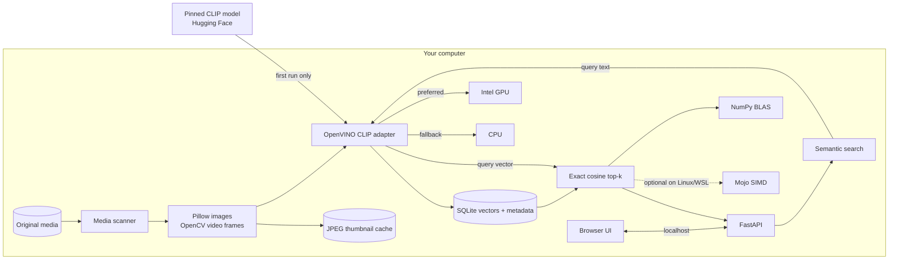

<div align="center">
  
  <h1>Lumen</h1>
  <p><strong>Describe a scene. Find the moment. Keep your media local.</strong></p>
  <p>
    Natural-language search for the photos and videos on your computer, powered
    by local CLIP embeddings and GPU acceleration.
  </p>
  <p>
    <a href="https://github.com/doktorigi/lumen-media-search/actions/workflows/ci.yml"></a>
    
    
    <a href="LICENSE"></a>
  </p>
</div>


<p align="center"><sub>Interface preview with synthetic media and sanitized demo status data.</sub></p>

Lumen searches visual meaning instead of filenames. Ask for “a red car in the
snow,” “birthday cake with candles,” or “sunset over the water.” Photos are
returned directly; videos are searched as sampled moments and open at the best
matching timestamp.

Your original files stay where they are. Lumen builds a local SQLite index of
normalized embeddings and a local JPEG thumbnail cache—no media upload or
hosted search service is involved.

> [!IMPORTANT]
> Lumen is an experimental, Windows-first project. It is useful today, but the
> index format and command-line interface may change before 1.0.

## Highlights

- Searches photos and sampled video frames with plain-language descriptions.
- Runs CLIP ViT-B/32 through OpenVINO on a detected Intel GPU, with a visible
  CPU fallback.
- Returns one card per asset and the strongest matching timestamp for videos.
- Skips unchanged files using canonical path, size, and nanosecond modification
  time.
- Recognizes OneDrive Files On-Demand placeholders without hydrating them.
- Keeps the browser API on loopback and protects private routes with a random,
  per-launch session token.
- Includes an experimental SIMD exact top-k kernel written in Mojo for
  Linux/WSL; native Windows uses the NumPy BLAS reference path.

## Quick start

### Requirements

- Windows 10 or 11 on x86-64. Windows 11 is the currently verified runtime.
- Python 3.11–3.14 and [`uv`](https://docs.astral.sh/uv/getting-started/installation/).
- A current Intel graphics driver for GPU inference. CPU fallback works when an
  OpenVINO-compatible GPU is unavailable.
- Internet access for the first model download (about 307 MB).

```powershell
git clone https://github.com/doktorigi/lumen-media-search.git
cd lumen-media-search
uv sync --locked
uv run lumen doctor --load-model
uv run lumen serve --open
```

The full doctor command downloads the pinned model, verifies every model file,
compiles it for the selected device, and performs image/text inference. Later
runs use the local model and OpenVINO compilation caches.

In the app:

1. Open **Library**.
2. Paste one or more absolute folder paths, one per line. A native folder picker
   is not implemented yet.
3. Select **Index folders** and leave Lumen open while it works.
4. Describe something you remember in the search box.

You can also index synchronously from PowerShell:

```powershell
uv run lumen index "D:\Photos" "D:\Family videos"
```

## How it works



Images contribute one vector each. Videos contribute an adaptive, uniformly
sampled set of at most 60 frame vectors. At query time Lumen embeds the text in
the same 512-dimensional space, performs exact cosine ranking, then collapses
frame hits into one result per file.

### Why OpenVINO and Mojo?

The production Windows embedding path is OpenVINO because it supports the Intel
integrated GPU used to build and verify Lumen. Native Windows ranking uses
NumPy BLAS.

The repository also contains a Mojo SIMD ranker as an experimental,
interchangeable backend. Mojo does not run natively on Windows, so its compiler
and runtime validation happen in Linux/WSL. As of MAX 26.4, Modular's supported
model catalog does not provide a CLIP/SigLIP joint embedding pipeline, and its
GPU requirements do not include Intel GPUs. A future MAX Graph implementation
would require a new embedding backend and a complete re-index.

- [Modular system requirements](https://docs.modular.com/packages/)
- [MAX supported models](https://docs.modular.com/models/)
- [Mojo–Python interoperability](https://mojolang.org/docs/manual/python/mojo-from-python/)
- [OpenVINO system requirements](https://docs.openvino.ai/2026/about-openvino/release-notes-openvino/system-requirements.html)

## Privacy and local data

Lumen is designed for personal libraries:

- Original photos and videos are read locally and are never uploaded by Lumen.
- The first model load contacts Hugging Face for one exact, public model
  revision. Downloads are unauthenticated, file-allowlisted, and checked against
  a built-in SHA-256 manifest.
- Hugging Face and Transformers telemetry are disabled inside the Lumen process.
  Lumen uses OpenVINO Runtime inference and does not invoke OpenVINO telemetry
  tools.
- The server refuses non-loopback bind addresses. A random launch secret creates
  an HttpOnly, same-site browser session before private API, media, or thumbnail
  routes can be used.
- API and media responses use `no-store`; search descriptions are sent in POST
  bodies rather than URL history or access logs.
- OneDrive cloud-only files are recorded as skipped, not downloaded.

The SQLite database contains full local paths and embeddings. The cache contains
recognizable thumbnails. Treat both as private data. `lumen clear` removes the
index and generated caches but never deletes original media. The command fails
closed when custom storage locations are broad, are not Lumen-named, or contain
an indexed media root.

The session token protects against drive-by web pages and ordinary unauthenticated
local requests. It is not a sandbox against administrators, compromised browser
extensions, debuggers, or malware already running as you.

## Media and platform support

| Area | Current support |
| --- | --- |
| Images | JPEG, PNG, WebP, BMP, TIFF, GIF, HEIC/HEIF, AVIF |
| Videos | MP4, MOV, M4V, MKV, WebM, AVI, WMV, MPEG/MPG |
| Accelerators | Intel GPU through OpenVINO; CPU fallback |
| Verified host | Windows 11 x86-64, Python 3.13, Intel UHD 620 |
| CI targets | Windows, Python 3.11–3.14 |
| Optional Mojo path | Linux/WSL with a compatible Mojo toolchain |

Actual HEIC/AVIF and video decoding depends on the codecs exposed by the local
Pillow and OpenCV builds.

## Configuration and commands

```text
lumen serve [--host 127.0.0.1] [--port 8765] [--open]
lumen doctor [--load-model]
lumen index PATH [PATH ...]
lumen clear [--yes]
```

| Environment variable | Default | Purpose |
| --- | --- | --- |
| `LUMEN_DEVICE` | `GPU` | OpenVINO device request; use `CPU` to force fallback |
| `LUMEN_HOST` | `127.0.0.1` | Loopback bind address only |
| `LUMEN_PORT` | `8765` | Local browser port |
| `LUMEN_DATA_DIR` | Per-user app data | SQLite index location |
| `LUMEN_CACHE_DIR` | Per-user cache | Model, compiled graph, and thumbnails |
| `LUMEN_IMAGE_BATCH_SIZE` | `8` | Photo inference batch size |
| `LUMEN_VIDEO_BATCH_SIZE` | `8` | Sampled-frame inference batch size |
| `LUMEN_VIDEO_MAX_FRAMES` | `60` | Maximum vectors stored per video |

`lumen doctor` lists visible OpenVINO devices without loading the model. Use
`lumen doctor --load-model` to learn the actual compiled device and verify an
end-to-end embedding.

### Mojo validation

On a compatible WSL/Linux system with `uv` already installed:

```powershell
wsl bash /mnt/c/path/to/lumen-media-search/scripts/validate_mojo.sh
```

The helper creates an isolated environment, pins Mojo 1.0.0b2, compiler-checks
the source, and runs a small top-k smoke test. Mojo/MAX is governed by Modular's
[Community License](https://www.modular.com/legal/community); running the helper
installs that optional SDK under its own terms.

## Limitations

- Lumen has no filesystem watcher or deleted-file reconciliation. Re-indexing
  skips unchanged assets but is not a full two-way filesystem sync.
- Uniform frame sampling can miss brief events. Audio and speech are not indexed.
- Exact search loads vectors into memory and scans them all; there is no
  approximate-nearest-neighbor index yet.
- CLIP similarity is not a probability or calibrated confidence score. The model
  works best with English descriptions and inherits biases from its training
  data. It is not intended for surveillance or facial recognition.
- OCR, named-person enrollment, captions, date/location filters, duplicate
  detection, and a native folder picker are not implemented.
- Windows is the tested application runtime. Other platforms may work but are
  not yet supported claims.

## Development

```powershell
uv sync --frozen --all-groups
uv run pytest
uv run pytest --cov=lumen_media
uvx ruff check .
uvx ruff format --check .
uv build
```

The test suite covers the store, deterministic ranking, media handling,
incremental indexing, API security, static application, and package-facing
behavior without requiring a model download. See [CONTRIBUTING.md](CONTRIBUTING.md)
for architecture and pull-request guidance, and [SECURITY.md](SECURITY.md) for
the threat model and private reporting process.

## Model and license

Lumen uses the MIT-tagged
[`scaleflex/clip-vit-base-patch32-openvino`](https://huggingface.co/scaleflex/clip-vit-base-patch32-openvino)
conversion pinned at revision
`26f5e9f1ec6185017f8a7422e63c8fc083403846`, derived from OpenAI's CLIP
ViT-B/32. See [THIRD_PARTY_NOTICES.md](THIRD_PARTY_NOTICES.md) for provenance,
checksums, licenses, and model limitations.

Lumen's source is released under the [MIT License](LICENSE).
